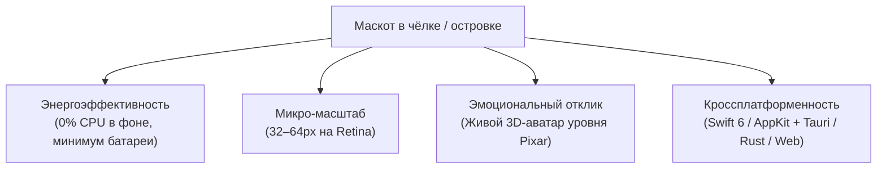
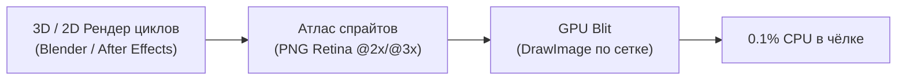
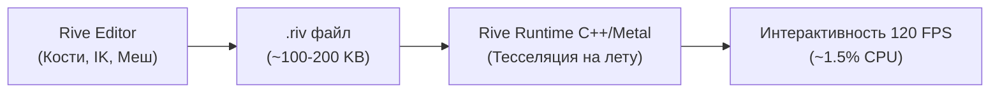
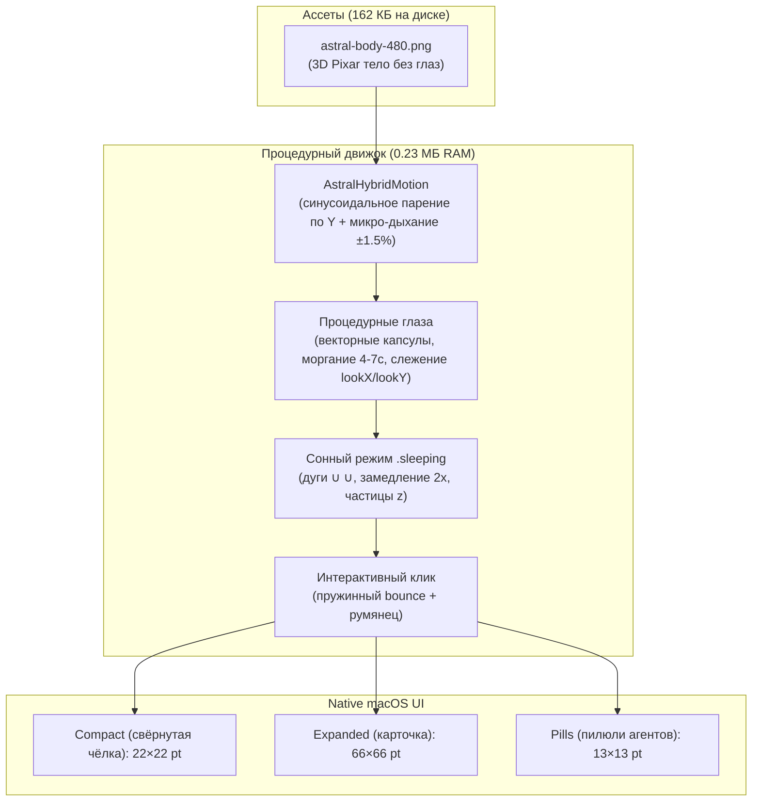

# Архитектура живого маскота: Эволюция от спрайт-листов к Гибридной модели (Variant 2)

> [!IMPORTANT]
> **Утверждённая архитектура (19 октября 2026 года):**
> По результатам измерений в реальной среде macOS notch утверждён **Гибридный подход (Вариант 2)**:
> - **Корпус:** 1 статичный 3D-мастер (`astral-body-480.png`, 162 КБ на диске, **0.23 МБ RAM** вместо 28.3 МБ покадрового атласа).
> - **Глаза и мимика:** векторный procedural-слой с поддержкой моргания, взгляда за курсором и трансформации в сонные дуги `∪ ∪`.
> - **Физика:** нативное синусоидальное парение по $Y$ и микро-дыхание (squash & stretch 1.5%), отклик на клик (poke bounce).
> - **Энергопотребление:** честные **0.0% CPU** при скрытой чёлке / паузе, менее 0.2% CPU при 120 FPS ProMotion.
> - **Размеры:** свёрнутая чёлка — **22×22 pt**, раскрытая карточка — **66×66 pt**, пилюли — **13×13 pt**.
> 
> Подробные спецификации и правила подключения:
> [MASCOT_HANDOFF.md](MASCOT_HANDOFF.md), [MASCOT_DESIGN_SPEC.md](MASCOT_DESIGN_SPEC.md), [MASCOT_ANIMATION_PLAN.md](MASCOT_ANIMATION_PLAN.md).

Создание маскота для строки состояния или чёлки экрана (MacBook Notch в `NotchBuddy` и плавающего островка в Windows/Tauri) ставит перед разработчиком жесткую систему инженерных ограничений:

* **Ограничение по энергопотреблению**: приложение висит в чёлке постоянно в течение всего рабочего дня разработчика. Маскот не имеет права греть процессор, крутить кулеры ноутбука или высаживать батарею. При скрытии островка потребление CPU обязано падать ровно в **0.0%**.
* **Масштаб и чёткость**: рабочая зона маскота в чёлке составляет от 32 до 64 пикселей (с множителем плотности пикселей Retina `@2x`/`@3x`). В таком разрешении любая грязь, размытые контуры или избыточная мелкая детализация превращаются в кашу.
* **Требование к «живости»**: персонаж не должен выглядеть статичной картинкой, покачивающейся на невидимой нитке. Нужны честные фазы горения пламени, динамика взгляда, взаимодействие с предметами (блокнот, книга, карандаш).

---

## 2. Анализ текущего подхода: почему процедурный Canvas не подошел

В оригинальном `NotchBuddy` персонаж Мочи реализован на чистом коде:
* **macOS**: `Canvas` + `TimelineView` в SwiftUI.
* **Windows/Linux**: 2D `<canvas>` с математическими кривыми Безье и формулами Ламе ($x^n + y^n = 1$).

### Границы применимости процедурного кода:
> [!NOTE]
> Процедурный Canvas идеален для **минималистичных геометрических индикаторов** (колобок, камушек, круглая капля). Там достаточно 4–6 точек Безье и двух овалов глаз.

Однако для персонажа уровня **Фликера (3D Flame Spirit)** этот подход терпит крах:
1. **Физика пламени**: живой огонь — это стохастический процесс. Язычки пламени непрерывно рождаются, скручиваются, отрываются и гаснут. Попытка смоделировать это уравнениями кривых на 60 FPS превращается в чудовищный математический оверхед, который при этом всё равно выглядит как пластиковый геометрический треугольник.
2. **Объёмный свет и текстуры (Subsurface Scattering)**: обаяние Фликера строится на мягком полупрозрачном желеобразном теле с светящимся горячим ядром внутри, мягких светотеневых переходах и объемных бликах. В стандартном 2D Canvas без тяжелых пиксельных шейдеров это имитировать невозможно.
3. **Кинематика предметов**: движения рук с блокнотом, пальцев с карандашом и перелистывания страниц требуют честных фаз рисунка, а не просто сдвига по координатам.

---

## 3. Вариант 1: Покадровая анимация (Sprite Sheets / Flipbook)

Покадровая анимация — классический подход из игровой индустрии (от файтингов до 2.5D платформеров) и высоконагруженных UI-виджетов.

### Как устроена архитектура:
Каждое состояние персонажа запекается в виде бесшовного зацикленного спрайт-листа (атласа) на 16–24 кадра:
* **`writing.png`**: цикл письма карандашом в блокноте с непрерывным переливом пламени.
* **`reading.png`**: цикл чтения книги с мерцающим светом на страницах и лице.
* **`thinking.png`**: задумчивое покачивание и закручивание пламени в вопросительный завиток.
* **`idle.png`**: плавное парение в невесомости и приветливые движения.

В коде движок просто рисует нужный кадр из атласа:
$$\text{кадр} = \lfloor (t \times \text{FPS}) \rfloor \pmod N$$

### Преимущества:
1. **Безупречное качество (10/10)**: 100% сохранение кинематографического света, теней, объема и очарования оригинального концепта.
2. **Экстремально низкий CPU (до 0.1%)**: процессор не вычисляет геометрию, кости или кривые. GPU выполняет примитивную операцию переноса текстуры (`texture blit`).
3. **Нулевая кодовая зависимость**: не требует подключения внешних библиотек (zero third-party dependencies), что полностью соответствует правилам проекта [CLAUDE.md](file:///Users/pavel/ai_helper_adaptation/CLAUDE.md#L24).
4. **Гарантированный 0% CPU при простое**: когда остров скрыт, таймер анимации просто останавливается.

### Ограничения:
* **Дискретность**: анимация запечена. Персонаж не может программно дотянуться лапкой до произвольной координаты экрана.
* **Расход памяти**: спрайт-листы требуют хранения текстур в памяти (для 4 состояний по 24 кадра в 120x120px это около 15–20 МБ RAM).

---

## 4. Вариант 2: Векторный скелетный рантайм (Rive)

Rive — передовая технология интерактивной векторной анимации со встроенными стейт-машинами, костями (skeletal rigging), сетками деформации (mesh deformation) и инверсной кинематикой (IK).

### Преимущества:
1. **Полная интерактивность**: глаза и голова могут аппаратно отслеживать точное положение курсора мыши в реальном времени. Лапки могут сгибаться по физике.
2. **Минимальный вес на диске**: векторный файл `.riv` весит всего 100–300 КБ для десятков анимаций.
3. **Бесконечная плавность**: кадры не запечены, интерполяция между состояниями рассчитывается математически на любой частоте экрана (60 / 120 Гц ProMotion).

### Ограничения:
* **Векторная эстетика против 3D-объема**: Rive работает с векторными путями и плоскими мешами. Передать в нем мягкое объемное свечение, реалистичный огонь с полупрозрачностью и светящееся ядро внутри тела крайне трудно — персонаж неизбежно станет более «векторно-плоским».
* **Нагрузка на CPU**: постоянный пересчет скелета и тесселяция векторных кривых на лету расходует около 1–2.5% CPU.
* **Сторонний рантайм**: требует интеграции `RiveRuntime` в проект (Swift Package на macOS и Wasm/JS на Windows).

---

## 5. Сравнительная матрица подходов

| Критерий | 🎞️ Покадровый атлас (48 кадров v2) | 🦴 Векторный скелет (Rive) | 🌟 **Гибридный подход (Вариант 2 — Утверждён)** |
| :--- | :---: | :---: | :---: |
| **Расход RAM на экземпляр** | **28.3 МБ** (распаковка $1536 \times 4608$) | ~2–5 МБ | **~0.23 МБ** (экономия 99.2%) |
| **Размер ассетов на диске** | 5.0 МБ на цикл | ~150–300 КБ | **162 КБ** (один мастер `astral-body-480.png`) |
| **Нагрузка на CPU (активно)** | 0.1% – 0.2% | 1.0% – 2.5% | **0.1% – 0.2%** (при 120 FPS ProMotion) |
| **Нагрузка на CPU (скрыт)** | **0.0%** (через TimelineView paused) | 0.0% | **0.0%** (через TimelineView paused) |
| **Визуальный стиль** | Кинематографичный 3D Pixar | Векторный 2D / 2.5D | **Кинематографичный 3D Pixar + чёткие векторные глаза** |
| **Стабильность кадров** | Артефакты нейросетевого морфинга/скачки | Высокая | **100% стабильность (нет мерцания и скачков)** |
| **Интерактивность** | Отсутствует (запечённые фазы) | Интерактивный скелет | **Слежение за курсором, моргание, poke bounce, сон** |
| **Зависимости в коде** | 0 библиотек (чистый SwiftUI/CoreGraphics) | Сторонний рантайм Rive C++/Metal | **0 библиотек (чистый SwiftUI/CoreGraphics)** |

---

## 6. Почему был отвергнут чистый покадровый атлас (v2)

Опыт нативного подключения атласа «Ты ещё тут? v2» (48 кадров, $1536 \times 4608$ px) на macOS выявил три критических проблемы:
1. **Скачки памяти (Memory Spikes):** при открытии чёлки распакованный в видеопамять буфер занимает 28.3 МБ. При наличии нескольких маскотов (главный экран + мини-пилюли задач агентов) память подскакивала на десятки мегабайт.
2. **Вес дистрибутива:** даже 2–3 состояния раздували ассеты приложения на 15–20 МБ.
3. **Нейросетевая нестабильность:** мелкие детали формы и свечения между кадрами диффузионной генерации слегка плавали, создавая высокочастотное мерцание при 24 FPS.

---

## 7. Утверждённая реализация: Гибридная архитектура (Вариант 2)

Реализована и зафиксирована в коде 19 октября 2026 года:

### Геометрия и отступы:
- **Свёрнутая чёлка (compact): 22×22 pt.** При стандартной высоте чёлки MacBook 32 pt персонаж имеет безопасный клиренс по 5 pt сверху и снизу. Нижние волны призрака гарантированно не срезаются.
- **Раскрытая карточка (expanded): 66×66 pt.** Идеально балансирует карточку высотой 84 pt, оставляя >11 pt клиренса до нижней границы и не перекрывая текст.
- **Пилюли агентов (pills): 13×13 pt.** Ровно вписываются в плашки агентов высотой 24 pt.

### Энергоэффективность (0.0% CPU):
`AstralHybridIdleHostView` отслеживает состояние окна и флаг `isPaused`. Когда чёлка свёрнута или окно скрыто, `TimelineView(.animation(paused: isPaused))` полностью останавливает такты — потребление CPU гарантированно падает в **0.0%**.

