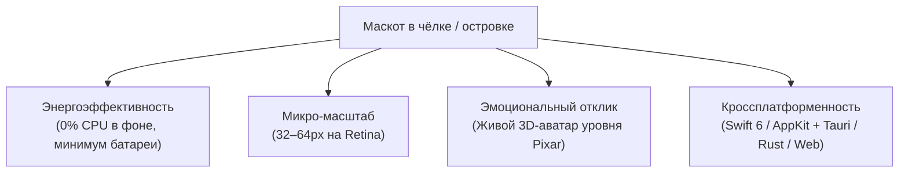
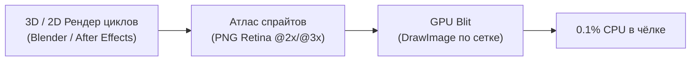
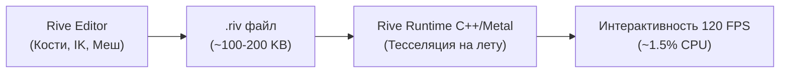

# Архитектура живого маскота: Покадровая анимация (Sprite Sheets) vs Векторный скелет (Rive)

> **Историческое исследование подходов.** Текст ниже предшествует выбору Astral v2.
> Утверждённый вид, огонёк A и реальный статус описаны в
> [действующей спецификации](MASCOT_DESIGN_SPEC.md) и
> [передаче работы](MASCOT_HANDOFF.md). Постоянное ядро, реквизит и численные
> обещания CPU ниже не являются принятыми ассетами или результатами измерений.
> Реальные промежуточные кадры и native-подключение нового набора ещё предстоят.

## 1. Введение и контекст среды

Создание маскота для строки состояния или чёлки экрана (MacBook Notch в `NotchBuddy` и плавающего островка в Windows/Tauri) ставит перед разработчиком жесткую систему инженерных ограничений:

* **Ограничение по энергопотреблению**: приложение висит в чёлке постоянно в течение всего рабочего дня разработчика. Маскот не имеет права греть процессор, крутить кулеры ноутбука или высаживать батарею. При скрытии островка потребление CPU обязано падать ровно в **0.0%**.
* **Масштаб и чёткость**: рабочая зона маскота в чёлке составляет от 32 до 64 пикселей (с множителем плотности пикселей Retina `@2x`/`@3x`). В таком разрешении любая грязь, размытые контуры или избыточная мелкая детализация превращаются в кашу.
* **Требование к «живости»**: персонаж не должен выглядеть статичной картинкой, покачивающейся на невидимой нитке. Нужны честные фазы горения пламени, динамика взгляда, взаимодействие с предметами (блокнот, книга, карандаш).

---

## 2. Анализ текущего подхода: почему процедурный Canvas не подошел

В оригинальном `NotchBuddy` персонаж Мочи реализован на чистом коде:
* **macOS**: `Canvas` + `TimelineView` в SwiftUI.
* **Windows/Linux**: 2D `<canvas>` с математическими кривыми Безье и формулами Ламе ($x^n + y^n = 1$).

### Границы применимости процедурного кода:
> [!NOTE]
> Процедурный Canvas идеален для **минималистичных геометрических индикаторов** (колобок, камушек, круглая капля). Там достаточно 4–6 точек Безье и двух овалов глаз.

Однако для персонажа уровня **Фликера (3D Flame Spirit)** этот подход терпит крах:
1. **Физика пламени**: живой огонь — это стохастический процесс. Язычки пламени непрерывно рождаются, скручиваются, отрываются и гаснут. Попытка смоделировать это уравнениями кривых на 60 FPS превращается в чудовищный математический оверхед, который при этом всё равно выглядит как пластиковый геометрический треугольник.
2. **Объёмный свет и текстуры (Subsurface Scattering)**: обаяние Фликера строится на мягком полупрозрачном желеобразном теле с светящимся горячим ядром внутри, мягких светотеневых переходах и объемных бликах. В стандартном 2D Canvas без тяжелых пиксельных шейдеров это имитировать невозможно.
3. **Кинематика предметов**: движения рук с блокнотом, пальцев с карандашом и перелистывания страниц требуют честных фаз рисунка, а не просто сдвига по координатам.

---

## 3. Вариант 1: Покадровая анимация (Sprite Sheets / Flipbook)

Покадровая анимация — классический подход из игровой индустрии (от файтингов до 2.5D платформеров) и высоконагруженных UI-виджетов.

### Как устроена архитектура:
Каждое состояние персонажа запекается в виде бесшовного зацикленного спрайт-листа (атласа) на 16–24 кадра:
* **`writing.png`**: цикл письма карандашом в блокноте с непрерывным переливом пламени.
* **`reading.png`**: цикл чтения книги с мерцающим светом на страницах и лице.
* **`thinking.png`**: задумчивое покачивание и закручивание пламени в вопросительный завиток.
* **`idle.png`**: плавное парение в невесомости и приветливые движения.

В коде движок просто рисует нужный кадр из атласа:
$$\text{кадр} = \lfloor (t \times \text{FPS}) \rfloor \pmod N$$

### Преимущества:
1. **Безупречное качество (10/10)**: 100% сохранение кинематографического света, теней, объема и очарования оригинального концепта.
2. **Экстремально низкий CPU (до 0.1%)**: процессор не вычисляет геометрию, кости или кривые. GPU выполняет примитивную операцию переноса текстуры (`texture blit`).
3. **Нулевая кодовая зависимость**: не требует подключения внешних библиотек (zero third-party dependencies), что полностью соответствует правилам проекта [CLAUDE.md](file:///Users/pavel/ai_helper_adaptation/CLAUDE.md#L24).
4. **Гарантированный 0% CPU при простое**: когда остров скрыт, таймер анимации просто останавливается.

### Ограничения:
* **Дискретность**: анимация запечена. Персонаж не может программно дотянуться лапкой до произвольной координаты экрана.
* **Расход памяти**: спрайт-листы требуют хранения текстур в памяти (для 4 состояний по 24 кадра в 120x120px это около 15–20 МБ RAM).

---

## 4. Вариант 2: Векторный скелетный рантайм (Rive)

Rive — передовая технология интерактивной векторной анимации со встроенными стейт-машинами, костями (skeletal rigging), сетками деформации (mesh deformation) и инверсной кинематикой (IK).

### Преимущества:
1. **Полная интерактивность**: глаза и голова могут аппаратно отслеживать точное положение курсора мыши в реальном времени. Лапки могут сгибаться по физике.
2. **Минимальный вес на диске**: векторный файл `.riv` весит всего 100–300 КБ для десятков анимаций.
3. **Бесконечная плавность**: кадры не запечены, интерполяция между состояниями рассчитывается математически на любой частоте экрана (60 / 120 Гц ProMotion).

### Ограничения:
* **Векторная эстетика против 3D-объема**: Rive работает с векторными путями и плоскими мешами. Передать в нем мягкое объемное свечение, реалистичный огонь с полупрозрачностью и светящееся ядро внутри тела крайне трудно — персонаж неизбежно станет более «векторно-плоским».
* **Нагрузка на CPU**: постоянный пересчет скелета и тесселяция векторных кривых на лету расходует около 1–2.5% CPU.
* **Сторонний рантайм**: требует интеграции `RiveRuntime` в проект (Swift Package на macOS и Wasm/JS на Windows).

---

## 5. Сравнительная матрица

| Критерий | 🎞️ Покадровая анимация (Sprite Sheets) | 🦴 Векторный скелет (Rive) |
| :--- | :---: | :---: |
| **Нагрузка на CPU** | **0.05% – 0.15% (идеально для чёлки)** | 1.0% – 2.5% |
| **Потребление батареи Mac** | Минимальное (кулеры отключены) | Заметное при непрерывной работе |
| **Визуальный стиль** | **Кинематографичный 3D Pixar** | Векторный 2D / 2.5D |
| **Плавность анимации** | 24–30 FPS (классический мультфильм) | 60–120 FPS (математическая интерполяция) |
| **Размер в RAM** | ~15–25 МБ | ~2–5 МБ |
| **Размер на диске** | ~2–4 МБ (PNG WebP) | **~150–300 КБ** |
| **Сложность внедрения в код** | **Минимальная (0 внешних библиотек)** | Средняя (интеграция рантайма Rive) |
| **Реакция на интерактив** | Переключение циклов + процедурный дрейф | Попиксельное слежение костями |

---

## 6. Стратегия реализации: План внедрения покадровой анимации

Так как приоритетом выбрана **покадровая анимация**, проект реализуется по следующему плану:

### Фаза 1. Подготовка графических ассетов (Asset Pipeline)
1. Для каждого из 4 базовых состояний генерируется бесшовный цикл из 20–24 кадров:
   * `Flicker_Idle` (Парение, дыхание, мерцание короны огня).
   * `Flicker_Writing` (Быстрое письмо карандашом в блокноте, кончик карандаша двигается, огонек вспыхивает ярче).
   * `Flicker_Reading` (Чтение открытой светящейся книги, мерцающий отсвет страниц на лице).
   * `Flicker_Thinking` (Задумчивый наклон, чешет огонек карандашом, пламя завивается в спираль).
2. Сборка кадров в оптимизированные горизонтальные/сетчатые спрайт-листы формата PNG с альфа-каналом.

### Фаза 2. Интеграция в движок (Engine Integration)
1. **SwiftUI / macOS (`NotchBuddy`)**:
   * Создание компонента `SpriteSheetView`: отображение нужного кадра через вырезку `rect` из предзагруженного `CGImage`.
   * Привязка частоты обновления к `TimelineView(.animation(paused: isHidden))`: при скрытии чёлки анимация мгновенно засыпает.
2. **Windows / Linux (`windows/`)**:
   * Внедрение метода в `engine.ts`: отрисовка через `ctx.drawImage` с шагом по спрайт-листу.

### Фаза 3. Микро-физика и гибридный слой
Поверх покадровой анимации код накладывает:
* Мягкий гармонический дрейф по $Y$ (парение в воздухе);
* Процедурные вылетающие частицы (золотые искры, пыльца, «z» при сне);
* Плавную смену состояний через альфа-блендинг (cross-fade 120ms).
