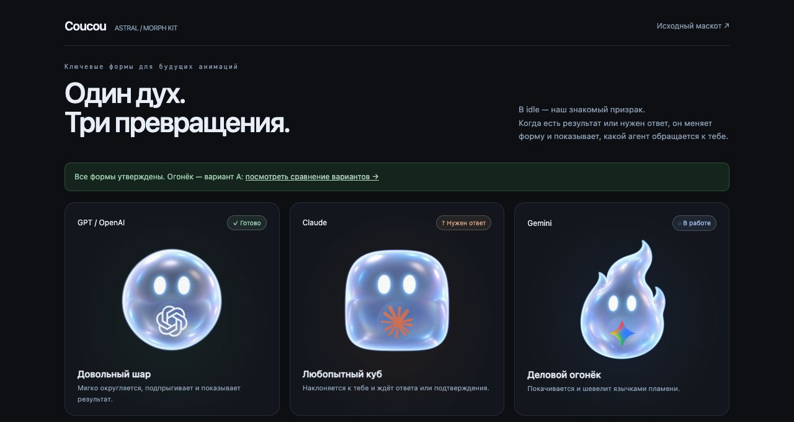

# Astral Morph — дизайн маскота и подготовка анимаций

Актуально на **17 октября 2026 года**. Эта спецификация фиксирует принятый дизайн
Astral для форка Coucou / NotchBuddy. Начать работу без истории чата можно с
[MASCOT_HANDOFF.md](MASCOT_HANDOFF.md).

**Готово:** утверждённые статичные PNG призрака, шара, куба и огонька A, размерные
экспорты, отдельные логотипы, составные SVG и HTML-примерки.
**Проба v2:** частичное улучшение idle «Ты ещё тут?» — 48 настоящих уникальных
рисунков на 4 с, 12 новых поз/с, 96 тактов при 24 fps (по два на рисунок).
Любопытный наклон заметнее, одно моргание сохранено; стык и отдельные скачки
не исправлены. V2 в целом не признана более плавной. V1 (32 рисунка/4 с,
8 новых поз/с) полностью сохранена в прежней папке и коммите `57420a6`.
**Предстоит:** финальные циклы и переходы, их упаковка для runtime
и подключение утверждённых изображений к работающему приложению.
Наличие классов Animator и процедурного Shapeshifter в коде не означает,
что новый растровый персонаж уже используется приложением.
Сценарий пробы, критерии проверки и две отложенные идеи записаны в
[плане анимаций](MASCOT_ANIMATION_PLAN.md). Открыть
[HTML-плеер v2](../design/mascot/astral-v2/animations/are-you-still-here-v2/index.html),
[README с ограничениями](../design/mascot/astral-v2/animations/are-you-still-here-v2/README.md),
[отчёт](../design/mascot/astral-v2/animations/are-you-still-here-v2/report.md) и
[сравнение v1/v2](../design/mascot/astral-v2/animations/are-you-still-here-v2/comparison.json).
Черновой цикл не означает готовность финальной анимации или native-интеграции.

## 1. Назначение и утверждённый образ

Astral — маленький живой спутник интерфейса: сообщает о работе агента, результате
и вопросе пользователю. Он должен быть милым, понятным в маленьком размере
и ненавязчивым при постоянной работе. Смена формы сохраняет узнаваемость персонажа.

Идентичность задаётся утверждёнными PNG, а не ранним концептом и не текущими
Canvas-фигурами в приложении. Если описание и изображение расходятся,
сохраняйте утверждённый образ и явно отмечайте расхождение.

| Форма | Утверждённый исходник | Признаки |
|---|---|---|
| Призрак, базовый idle | [astral-idle-master.png](../design/mascot/astral-v2/astral-idle-master.png) | Мягкая куполообразная голова, три округлые волны снизу, две маленькие лапки |
| Шар | [astral-orb-master.png](../design/mascot/astral-v2/morph-kit/masters/astral-orb-master.png) | Круглый объём, лапки и нижние волны поглощены телом |
| Мягкий куб | [astral-cube-master.png](../design/mascot/astral-v2/morph-kit/masters/astral-cube-master.png) | Надутый скруглённый куб, мягкие углы, лёгкий объём боковых поверхностей |
| Огонёк A | [astral-wisp-master.png](../design/mascot/astral-v2/morph-kit/masters/astral-wisp-master.png) | Цельное пламя без лапок, три языка вверх, широкое округлое основание |

Огонёк A выбран пользователем и заменил первую форму, похожую на запятую.
Канонический мастер побайтово совпадает с
[кандидатом A](../design/mascot/astral-v2/morph-kit/wisp-candidates/a-candle.png).
Буква A — выбор пользователя; `a-candle` в имени файла осталось от промпта.
Сам результат имеет несколько язычков, это не требование сделать свечную каплю.
Кандидаты B/C и [первый огонёк](../design/mascot/astral-v2/morph-kit/wisp-candidates/previous-wisp.png)
сохранены для истории и не являются вариантами по умолчанию.



Снимок показывает примерку; форму, лицо и материал сверяйте с PNG-мастерами.

## 2. Визуальный стиль

- Материал — светящееся полупрозрачное матовое стекло / перламутровое желе,
  с мягкой объёмной светопередачей. Основной цвет ледяной серебристо-голубой,
  по краям слабые сиреневые и голубые переливы.
- Свет — мягкий студийный сверху слева. Отражения плавные, контур различим
  на чёрном и светлом фоне; ореол не должен размывать силуэт.
- Лицо — ровно два светящихся белых вертикальных овальных глаза.
  У базовых утверждённых поз нет тёмных зрачков, носа, рта и румянца.
  В будущих кадрах допустимы моргание, взгляд и выражение глаз в этой идентичности.
- Камера — преимущественно фронтальная, почти ортографическая.
  При превращении сохраняются масштаб лица, направление света и материал.
- Постоянного внутреннего ядра **нет**. Пользователь убрал его из-за сходства с носом.
  Логотип, появляющийся в событийной форме ниже глаз, — отдельный сменный знак.
- У выбранного огонька нет длинного нижнего хвоста, крючка или серповидного выреза.
  Пламя читается за счёт верхних язычков, основание мягкое и непрерывное.

Не возвращайте плоские круги, чёрные глаза с бликами, круговой контур вокруг куба,
румянец, постоянную звезду/шарик в центре лица, чрезмерное неоновое свечение.
Не добавляйте предметы, одежду и новые декоративные детали как часть базового дизайна.
Изменение идентичности — отдельный редизайн, а не незаметная часть генерации кадров.

## 3. Где лежат файлы

Все пути ниже отсчитываются от корня репозитория и не зависят от машины.

| Путь | Назначение |
|---|---|
| [design/mascot/astral-v2/](../design/mascot/astral-v2/README.md) | Основной набор призрака и инструкция |
| [astral-idle-master.png](../design/mascot/astral-v2/astral-idle-master.png) | Исходный PNG 1254×1254, без изменений |
| [astral-idle-normalized.png](../design/mascot/astral-v2/astral-idle-normalized.png) | Призрак с нормализованными полями, 1016×1016 |
| [sizes.json](../design/mascot/astral-v2/sizes.json) | 245 экспортов призрака, плотности, SHA-256 и места использования в коде |
| [sizes.html](../design/mascot/astral-v2/sizes.html) | Каталог размеров призрака |
| [morph-kit/](../design/mascot/astral-v2/morph-kit/README.md) | Шар, куб, огонёк A и сменное брендирование |
| [review.json](../design/mascot/astral-v2/morph-kit/review.json) | Машиночитаемый статус утверждения форм и знаков |
| [animation-blueprint.json](../design/mascot/astral-v2/morph-kit/animation-blueprint.json) | Формы, области логотипов и предполагаемые будущие циклы |
| [morph-kit/index.html](../design/mascot/astral-v2/morph-kit/index.html) | Три формы × три агента, интерактивная замена логотипа |
| [morph-kit/masters/](../design/mascot/astral-v2/morph-kit/masters) | Канонические PNG шара, куба и огонька A |
| [morph-kit/frames/](../design/mascot/astral-v2/morph-kit/frames) | Статичные размерные экспорты форм; название папки не означает наличие анимации |
| [morph-kit/logos/](../design/mascot/astral-v2/morph-kit/logos) | OpenAI, Claude, Gemini и лицензия библиотеки знаков |
| [morph-kit/examples/](../design/mascot/astral-v2/morph-kit/examples) | Девять самостоятельных составных SVG для примерки |
| [generation.json призрака](../design/mascot/astral-v2/generation.json), [форм](../design/mascot/astral-v2/morph-kit/generation.json), [кандидатов огонька](../design/mascot/astral-v2/morph-kit/wisp-candidates/generation.json) | Промпты imagegen, происхождение и контрольные суммы |
| [mascot-generated-v2.html](../design/prototype/mascot-generated-v2.html) | Статичная примерка призрака в чёлке, острове и Flow |

`design/prototype/astral_morph_concept.jpg`, `mascot-showcase.html` и старые снимки
в `design/captures/` — история концепта и интерфейсные ориентиры, не утверждённая
внешность Astral v2. В частности, показанное в них ядро возвращать не нужно.

## 4. Размеры, плотности и прозрачные поля

**Призрак:** 49 логических размеров от 12 до 240, каждый в 1×, 1.5×, 2×, 3×, 4×;
итого 245 RGBA PNG в `design/mascot/astral-v2/png/`.
Полный перечень и назначение размеров — в `sizes.json`.
Пример: `astral-idle-26@2x.png` содержит 52×52 физических пикселя для слота 26.

**Шар, куб, огонёк A:** каждый имеет ровно пять квадратных экспортов
**64, 240, 480, 720, 960 px** в `morph-kit/frames/`.
Это не дополнительные 245 файлов на форму. Исходники всех трёх — 1254×1254.
Для промежуточного размера берите ближайший больший экспорт и уменьшайте
с сохранением пропорций; 240/480/720/960 соответствуют плотностям базового холста 240.
Не выдавайте физические 240 px за обязательные 240 pt интерфейса.

Призрак нормализован обрезкой `(x=119, y=133, w=1016, h=1016)`.
Формы сохраняют поля своих генераций: их нельзя автоматически обрезать той же рамкой.
Размер холста не равен размеру видимого тела. Перед сборкой настоящей анимации
нужно совместить масштаб лица, центр и безопасные поля всех ключевых поз.

Фон — настоящий альфа-канал, не нарисованная шахматная сетка.
Сохраняйте полупрозрачные края. Проверяйте обрезание язычков, лапок и свечения
на тёмной/светлой подложке и на реальном размере интерфейса.
В старой HTML-примерке исходный призрак увеличен CSS на 132%; этот приём
не переносится на уже нормализованные PNG и другие формы.

## 5. Логотипы и замена компании

Форма передаёт состояние, логотип — того, кто обращается к пользователю.
Один агент может быть и шаром, и кубом. Для GPT используется знак OpenAI.
Утверждены отдельные `openai.svg`, `claude.svg`, `gemini.svg`; корпоративный знак
пока не выбран. Будущий логотип компании должен подставляться тем же способом.

**Слои:** тело → логотип ниже лица → лёгкая стеклянная подсветка поверх знака.
Знак не перерисовывается imagegen в каждом кадре и не зашивается в мастер тела.
Составные SVG в `examples/` служат готовыми примерами: внутрь встроены
PNG тела 480×480 и отдельный знак. Тело в них растровое, не бесконечно масштабируемое.

Текущее положение знака нормализовано относительно квадратного холста:

| Форма | Центр X | Центр Y | Ширина | Высота |
|---|---:|---:|---:|---:|
| Шар | 0.500 | 0.655 | 0.220 | 0.220 |
| Куб | 0.500 | 0.660 | 0.230 | 0.230 |
| Огонёк A | 0.500 | 0.735 | 0.190 | 0.190 |

Это координаты **текущих неподвижных поз**. В анимации нужны координаты,
угол, прозрачность и при необходимости маска перекрытия для каждого кадра.
Знак не должен становиться носом, пересекать глаза или закрывать их выражение.
Во время превращения он скрыт; после стабилизации формы проявляется.
При возврате к idle исчезает. На логическом размере меньше 48 используйте
внешнюю метку агента и подпись вместо нечитаемого внутреннего знака.

Команды из корня репозитория, без обращения к генератору изображений:

```sh
python3 scripts/compose-astral-logo.py
python3 scripts/compose-astral-logo.py --logo /path/to/company.svg --name company
```

Первая пересобирает девять SVG, вторая создаёт три SVG для компании.
Допустим прозрачный PNG; `--output` меняет папку результата.
Примерка своего файла в HTML использует локальный object URL без отправки файла.
Источники знаков и MIT-текст Lobe Icons сохранены в наборе; не теряйте атрибуцию.

## 6. Будущее поведение и переходы

Утверждённые idle-сценки и их отдельные статусы — в
[MASCOT_ANIMATION_PLAN.md](MASCOT_ANIMATION_PLAN.md): «Ты ещё тут?» — черновой цикл
v2 содержит 48 настоящих уникальных рисунков/4 с (12 новых поз/с),
96 тактов при 24 fps, ровно по два такта на рисунок без повтора рисунка 0 в конце.
Это частичное улучшение наклона и числа рисунков, стык и скачки не исправлены.
По итоговому сравнению стык 47→0: ширина 284→260 px (8,45% против 8,33% v1),
высота 297→283 px (4,71% против 3,77% v1); худший скачок высоты 39→40 —
8,96% против 7,90% v1. Основной part3 оставлен исходным; единственный
исправляющий кандидат отклонён основным агентом: он смягчил сжатие/расправление,
но увеличил скачок ширины на стыке до 12,16%. Кандидат с метриками сохранён отдельно.
Следующий шаг — согласовать позы, стык и свет, затем новые промежуточные
рисунки до 24 уникальных/с; текущая документационная задача не запускает генерацию.
«Сонный поплавок»
и «Игра с собственной формой» утверждены как идеи и отложены.

Рабочая раскладка в blueprint:

| Состояние | Форма и поведение |
|---|---|
| Idle | Призрак без постоянного знака; парение, моргание, милые короткие игры с формой |
| Работа | Огонёк A; покачивание тела и верхних язычков, внимательные глаза |
| Агент закончил | Шар со знаком агента; мягкое округление и довольный подскок |
| Вопрос / подтверждение | Куб со знаком агента; любопытный наклон и ожидание ответа |
| Возврат к idle | Знак исчезает, возвращаются лапки и нижние волны призрака |

Пользователь утвердил внешний вид и идею событийных превращений.
Конкретные длительности, приоритеты конкурирующих событий, поведение error/sleeping,
а также reading/thinking и реквизит ещё не закрыты отдельными анимациями.
Не считайте ранние описания планшета, книги или сердитого румянца утверждёнными кадрами.

В `planned_clips` уже есть ориентиры: idle 48 кадров, ghost→orb 16,
результат шара 24, ghost→cube 18, ожидание куба 36, ghost→wisp 18,
работа огонька 24, возврат в призрака 16; базово 24 FPS.
Это **черновые количества**, а не готовые файлы и не текущий контракт загрузчика.
Короткий пробный idle-цикл уже создан для проверки идентичности; его доводка
и переходы ещё предстоят до генерации всего набора.

Покадровый переход должен показывать реальные фазы: лапки втягиваются,
нижние волны округляются, тело перетекает, затем мягко успокаивается.
Смена картинки, crossfade, CSS scale или скругление прямоугольника не заменяют
покадровую анимацию превращения. У циклов проверяются стык начала/конца,
отсутствие дрожания света, формы и положения глаз.

## 7. Состояние приложения и точки подключения

Растровые файлы сейчас лежат в `design/`. Они не подключены к native resources.
HTML-примерки и SVG — дизайн-артефакты, не доказательство внедрения.

| Зона | Файлы и текущее положение |
|---|---|
| macOS, остров | [BotCanvasView.swift](../NotchBuddy/Sources/App/BotCanvasView.swift), [IslandRootView.swift](../NotchBuddy/Sources/App/IslandRootView.swift): существующая развилка Mochi / Shapeshifter |
| macOS, адаптер | [ShapeshifterHostView.swift](../NotchBuddy/Sources/CoucouKit/Mascots/Shapeshifter/ShapeshifterHostView.swift): выбор размеров и перевод состояний |
| macOS, маленький маскот | [ShapeshifterCompactView.swift](../NotchBuddy/Sources/CoucouKit/Mascots/Shapeshifter/ShapeshifterCompactView.swift): процедурный Canvas, не новые PNG |
| macOS, крупный маскот | [ShapeshifterExpandedView.swift](../NotchBuddy/Sources/CoucouKit/Mascots/Shapeshifter/ShapeshifterExpandedView.swift): попытка загрузки полосы кадров, иначе процедурный fallback |
| macOS, Hub | [FlowHubMochis.swift](../NotchBuddy/Sources/App/FlowHubMochis.swift): `HubLiveMascot` и hero Shapeshifter только у TunnelGuard; прочие сцены могут оставаться Mochi |
| macOS, рабочий стол | [DesktopMochi.swift](../NotchBuddy/Sources/App/DesktopMochi.swift): отдельный BotEngine, не автоматически новый маскот |
| iPhone | [MochiStill.swift](../NotchBuddy/Sources/CoucouKit/MochiStill.swift), [MochiLive.swift](../NotchBuddy/Sources/Phone/MochiLive.swift): отдельные поверхности |
| iOS, виджеты | [CoucouWidgets.swift](../NotchBuddy/Sources/Widgets/CoucouWidgets.swift), [MochiLiveActivity.swift](../NotchBuddy/Sources/Widgets/MochiLiveActivity.swift): отдельное подключение, включая tinted/monochrome режим |
| Windows / Linux | [shapeshifter-host.ts](../windows/src/mascot/shapeshifter-host.ts), [island.ts](../windows/src/island/island.ts): фасад вызывает процедурные рисовальщики; [minibots.ts](../windows/src/mochi/minibots.ts) — самостоятельный путь |
| Android | [MochiView.kt](../android/app/src/main/kotlin/com/coucou/android/mochi/MochiView.kt), [MochiBitmap.kt](../android/app/src/main/kotlin/com/coucou/android/app/MochiBitmap.kt): самостоятельные отрисовка и виджетные bitmap |

При подключении сохраняйте существующие точки входа, резервную отрисовку Mochi,
стабильные ID пилюль и поведение интерфейса вокруг персонажа.
`cube` в артефактах соответствует нынешнему `MascotShape.squircle`, `wisp` —
`flameWisp`. Отдельной ghost-формы в этом enum пока нет.

Текущий mapper переводит working→writing, searching→reading,
question/permission→approval, finished попадает в default→idle.
Поэтому finished/question/permission нужно сохранить до этого преобразования,
иначе новая событийная форма потеряет причину появления.
Определение провайдера также требует явной проверки: Swift распознаёт openai/gpt,
но не codex; Windows-фасад сейчас различает Claude и общий Antigravity fallback.
Наличие трёх SVG не исправляет эту маршрутизацию автоматически.

### Контракт существующего загрузчика

[SpriteSheetAnimator.swift](../NotchBuddy/Sources/CoucouKit/Mascots/Shapeshifter/SpriteSheetAnimator.swift)
ищет `astral_<action>.png` в bundle, сначала в `Mascots/Shapeshifter`, затем в корне.
Ожидаются горизонтальные полосы кадров 240×240:

| Action | Кадров | FPS |
|---|---:|---:|
| idle | 20 | 24 |
| writing | 24 | 24 |
| reading | 20 | 24 |
| thinking | 18 | 24 |
| approval | 16 | 24 |
| error | 16 | 24 |
| sleeping | 16 | 16 |

Эти настройки есть и в [sprite-animator.ts](../windows/src/mascot/sprite-animator.ts),
но они не реализуют новые циклы автоматически. Не переименовывайте одиночный
`astral-wisp-240.png` или `astral-idle-240.png` в `astral_idle.png`:
загрузчик нарежет его как многокадровую полосу. В нём нет новых actions
finished и shape-transition, а выбранная `shape` не задаёт отдельное имя полосы.
До упаковки новых циклов согласуйте контракт действий, метаданных и загрузки.

В нынешнем ExpandedView при `isPaused=true` ветка sprites пропускается и рисуется
процедурный fallback. При внедрении растрового образа пауза должна сохранять его
идентичность, а не менять рисунок на старый векторный персонаж.

Производительность проверяйте измерениями: нет постоянных обновлений в скрытом
состоянии, декодирование и кэширование изображений не повторяются каждый кадр.
Цифры 0% / 0.1% CPU из ранних документов не являются результатами измерения этого набора.

## 8. Продолжение работы и приёмка

1. Проверить статусы и визуально открыть утверждённые мастера.
2. По конкретной задаче выбрать этап: ещё один дизайн, пробная анимация или внедрение.
3. Для анимации сначала сделать короткий цикл и один переход на общем холсте;
   сохранить промежуточные кадры отдельно от утверждённых исходников.
4. Проверить лицо, свет, силуэт, размер, стык цикла и область логотипа.
5. Сверить будущий формат с загрузчиками, упаковать кадры и метаданные.
6. Подключать к одной поверхности за раз, затем проверять остальные платформы.
7. Обновить пути, статусы и документированные ограничения вместе с изменениями.

Критерии готовности следующего результата:

- утверждённые PNG не перегенерированы без задачи на редизайн;
- в покадровой анимации нет скачков масштаба, света и лица;
- огонёк сохраняет верхнее пламя A и широкое основание;
- логотип заменяется без генерации тела, не закрывает лицо и не превращается в нос;
- на маленьком размере читаются глаза и силуэт, а знак выносится наружу;
- нет клиппинга в чёлке и дрожания центра при переходах;
- отсутствует подмена растрового персонажа старым Canvas при паузе;
- явно названы проверенные поверхности; HTML-примерка не считается native-проверкой.

Для файлов призрака доступна проверка:

```sh
python3 scripts/export-astral-mascot.py --check
```

Она проверяет **только 245 экспортов призрака**, не весь morph-kit.
Для форм сверяйте PNG-размеры, RGBA/альфу, SHA-256 мастеров из generation.json,
совпадение выбранного A с основным огоньком и тело внутри трёх составных SVG.
Оригиналы шар/куб/логотипы при правке огонька должны оставаться без изменений.

После изменения native-кода выбирайте релевантные проверки из
[scripts/test-all-mascot.sh](../scripts/test-all-mascot.sh) и сборку затронутой платформы.
Существующие тесты проверяют инфраструктуру; зелёный тест сам по себе не подтверждает
качество картинки, подключение новых ресурсов или измеренную экономию CPU.

## 9. История и приоритет источников

Приоритет: текущие указания пользователя → эта спецификация и утверждённые
мастера → `review.json`, карты размеров и blueprint → исторические материалы.
При несогласованности текущих файлов исправьте или сообщите её явно.
`planned_clips` — проект будущих циклов; статус approved-static-key-poses
не распространяется на готовность анимации или сборки приложения.

Важные локальные коммиты, не обязательные для восстановления контекста:

- `24c7865` — исходный призрак и 245 размерных экспортов;
- `a0c43fc` — формы и сменные знаки;
- `d6ed194` — варианты огонька;
- `048d8cc` — принят огонёк A, обновлены пять размеров и три знака.

Ранняя спецификация сохранена в
[архиве](archive/2026-10-16-mascot-initial-design.md).
[MASCOT_ANIMATION.md](MASCOT_ANIMATION.md), [FORK_SYNC_MASCOT.md](FORK_SYNC_MASCOT.md)
и планы от 2026-10-16 описывают прежние исследования/реализацию; их заявления
о ядре, лице, CPU и полной готовности не заменяют текущий статус.
