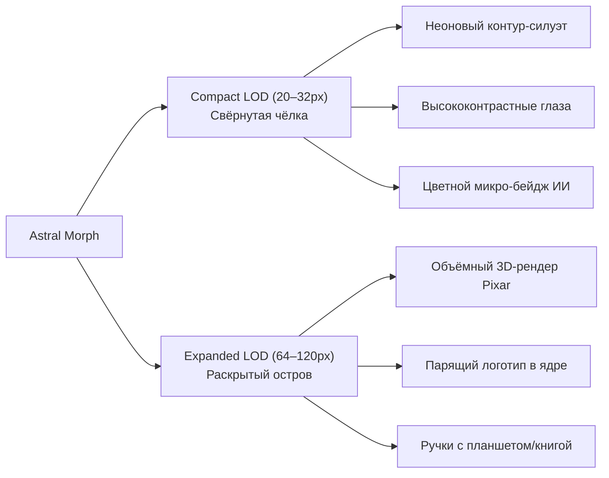

# Спецификация маскота: Призрак-Метаморф (The Astral Morph)

## 1. Концепция и идентичность персонажа

**«Призрак-Метаморф» (The Astral Morph)** — это цифровой дух чистой энергии и жидкого света, живущий в интерфейсе чёлки MacBook и плавающего островка Windows. 

В отличие от статичных маскотов, его ключевая суперсила — **морфологическая адаптивность**:
1. Он легко перетекает из мягкого призрачного огонька в скругленный технологичный куб (squircle) или сферу.
2. Внутри своего полупрозрачного светящегося тела (ядра) он может **удерживать логотип активного ИИ-агента** (Claude, Gemini, Antigravity, OpenAI) или **фирменный логотип компании**.
3. Он реагирует на контекст работы: читает документацию, быстро строчит код в светящийся блокнот, чешет макушку в размышлениях или сворачивается в уютный спящий шарик.

---

## 2. Система масштабирования: Два уровня детализации (LOD)

Рабочая среда чёлки требует радикально разного подхода к графике в зависимости от режима:

### А. Свёрнутая чёлка: Compact LOD (20–32px)
* **Проблема**: В масштабе 20–32px микродетали (пальцы, страницы, сложные текстуры) неизбежно сливаются в мыльное пятно.
* **Решение**: Иконический высококонтрастный силуэт.
  * **Форма**: Чистый неоновый абрис призрака с мягким внешним ореолом свечения.
  * **Лицо**: Крупные, читаемые за долю секунды белые глаза-пилюли (pill eyes), реагирующие на курсор.
  * **Брендинг / ИИ**: Крошечная светящаяся метка (badge) цвета активного провайдера (терракотовый для Claude, сине-фиолетовый для Gemini, изумрудный для OpenAI).

### Б. Раскрытая чёлка: Expanded LOD (64–120px)
* **Визуальный стиль**: Кинематографичный 3D-образ из живого полупрозрачного стекла / светящейся плазмы (эффект Subsurface Scattering).
* **Ядро с логотипом**: Внутри прозрачного животика парит объемный светящийся символ:
  * Звезда Claude / кристалл Gemini / квантовая сфера Antigravity / логотип компании.
* **Лапки и предметы (Props)**:
  * В режиме генерации кода держит светящийся мини-планшет или блокнот;
  * При чтении репозитория держит открытую книгу с светящимися страницами;
  * При ошибке — сломанный карандаш и сердитый румянец.

---

## 3. Формы метаморфоз (Shapeshifting Shapes)

В зависимости от настроек или типа активного сервиса маскот плавно меняет базовую форму:

1. **Squircle-Cube (Мягкий куб)**:
   * Идеален для корпоративного брендинга, IT-продуктов и отображения строгих логотипов.
   * Напоминает стеклянный кубик с живыми глазками.
2. **Orb (Сфера / Капля)**:
   * Минималистичный универсальный вид для режима ожидания (Idle) и медитативного фокуса.
3. **Flame Wisp (Призрак-Огонёк)**:
   * Динамичная форма с язычками пламени на макушке, активируется при активной компиляции или генерации кода.

---

## 4. Пайплайн покадровой анимации (Sprite Sheets)

Чтобы гарантировать **нулевую нагрузку на процессор (< 0.1% CPU)** и сохранить кинематографическое 3D-качество:

### Спецификация циклов анимации:
Каждое действие запекается в зацикленный спрайт-лист:

| Состояние | Действие | Предметы / Детали | Кол-во кадров | Частота |
| :--- | :--- | :--- | :---: | :---: |
| **`idle`** | Мягкое парение, дыхание, мерцание ядра | Парит в воздухе, ядро плавно пульсирует | 20 кадров | 24 FPS |
| **`writing`** | Быстро пишет код | Строчит стилусом в светящийся планшет | 24 кадра | 24 FPS |
| **`reading`** | Изучает файлы / документацию | Держит книгу, отсвет страниц на лице | 20 кадров | 24 FPS |
| **`thinking`** | Размышляет над промптом | Задумчивый наклон, пламя в виде завитка | 18 кадров | 24 FPS |
| **`approval`** | Ждёт подтверждения пользователя | Радостно подпрыгивает, машет обеими лапками | 16 кадров | 24 FPS |
| **`error`** | Сбой компиляции / ошибка сети | Оболочка краснеет, возмущенный взгляд | 16 кадров | 24 FPS |
| **`sleeping`** | Режим ожидания / ночь | Сворачивается клубочком, дыхание | 16 кадров | 16 FPS |

### Технические параметры ассетов:
* **Формат**: PNG с 8-битным альфа-каналом (прозрачный фон).
* **Сетка**: Горизонтальная полоса (Strip) или матрица $4 \times 5$.
* **Разрешение**: 
  * Expanded: $240 \times 240$ px на кадр (идеально для Retina `@2x`/`@3x`).
  * Compact: $64 \times 64$ px на кадр.

---

## 5. Статус реализации (Implementation Status)

Все ключевые компоненты архитектуры Astral Morph полностью реализованы и верифицированы кросс-платформенно:

- [x] **Изоляция настроек и типов**:
  - macOS: `NotchBuddy/Sources/CoucouKit/Mascots/Shapeshifter/MascotTypes.swift`, `MascotSettings.swift`
  - Windows: `windows/src/mascot/types.ts`, `settings.ts`
  - Дефолтное переключение на `.shapeshifter` с безопасным fallback при повреждённых ключах.
- [x] **24 FPS контроллер спрайтовой анимации**:
  - `SpriteSheetAnimator.swift` и `sprite-animator.ts` с поддержкой horizontal strip и matrix раскладки.
  - 0% CPU при паузе / скрытии острова (нулевые тики).
- [x] **Двухуровневый рендеринг (LOD)**:
  - **Compact LOD (20–32px)**: неоновый абрис, глаза-пилюли с трекингом взгляда, бейдж цвета провайдера с астральным fallback `#64D2FF`.
  - **Expanded LOD (64–120px)**: 3D глассморфизм с мягким ореолом, парящее ядро с гармоническими колебаниями $y = \sin(2\pi \cdot \text{phase}) \cdot 2.5\text{pt}$ и адаптивным цветом под провайдера.
- [x] **Фасад-адаптер нулевых конфликтов**:
  - `ShapeshifterHostView.swift` интегрирован в `BotCanvasView.swift` и `MiniBotCanvasView.swift`.
  - `renderMascotFacade` интегрирован в `windows/src/island/island.ts`.
  - Полное сохранение апстримной логики Мочи при выборе `.mochi`.
- [x] **Тестовое покрытие и билд**:
  - Модульные тесты настроек, аниматора, Compact LOD, Expanded LOD и фасада.
  - Сквозной E2E-тест `tests/AstralMorphE2ETests.swift`.
  - Успешный билд `xcodegen && xcodebuild -scheme NotchBuddy -configuration Debug build`.

